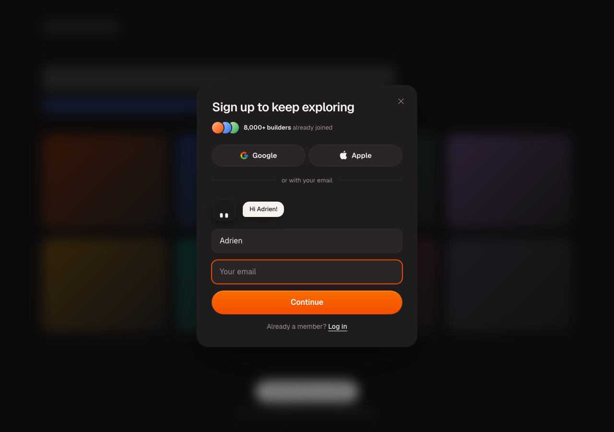
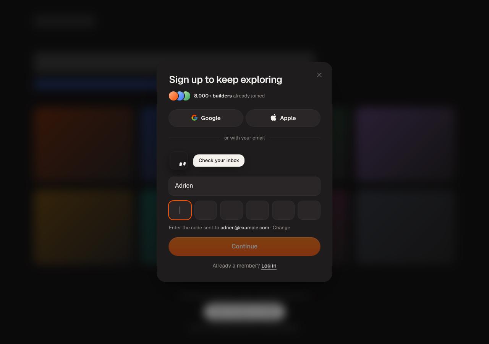
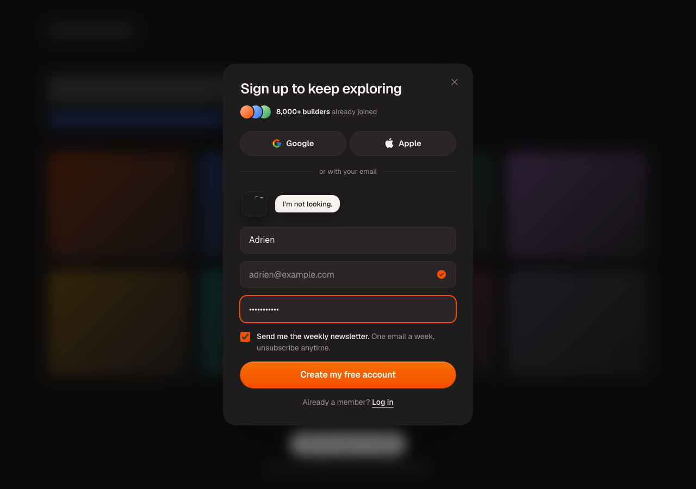

# Signup Buddy

A sign-up modal with a little mascot that watches you type.

- Its eyes follow your text cursor, letter by letter
- It shuts its eyes when you type your password
- It greets you by name, hops when a step is done, shakes its head at an error
- The form grows one field at a time: name, then email, then password
- The email is confirmed with a 6-digit code, right where the email field was
- Google and Apple buttons, a "Log in" mode, and a "forgot password, send me a code" mode
- A bottom sheet on phones, a centred modal on desktop

<p align="center">
  
  
  
</p>

It's React 19 + Tailwind CSS v4, no other dependencies. Bring your own auth: Supabase, Clerk, Better Auth, Firebase, your own API.

## Install

With the shadcn CLI:

```bash
npx shadcn@latest add https://raw.githubusercontent.com/Logiaweb/signup-buddy/main/public/r/signup-buddy.json
```

Or copy the [`components/signup-buddy`](components/signup-buddy) folder into your project. It's three files.

## Use

```tsx
"use client";

import { useState } from "react";
import { SignupModal } from "@/components/signup-buddy";

export function SignUpButton() {
  const [open, setOpen] = useState(false);

  return (
    <>
      <button onClick={() => setOpen(true)}>Sign up</button>
      <SignupModal
        open={open}
        onClose={() => setOpen(false)}
        onSuccess={() => window.location.assign("/dashboard")}
        socialProof={{ count: "8,000+ builders", label: "already joined" }}
        sendCode={async (email, purpose) => {
          // Email a 6-digit code. Return { error } to show a message.
        }}
        verifyCode={async (email, code, purpose) => {
          // "signup": only proves the email. "login": signs them in.
          // Return { error: "That code didn't work." } when it's wrong.
        }}
        signUp={async ({ name, email, password, newsletter }) => {
          // Create the account. The email is already verified here.
        }}
        logIn={async ({ email, password }) => {
          // Check the password.
        }}
        onOAuth={async (provider) => {
          // Redirect to Google or Apple.
        }}
      />
    </>
  );
}
```

Every auth callback returns nothing when it worked, or `{ error: "message" }` to show the message (the mascot shakes its head too). `signUp` can also return `{ error, codeExpired: true }` to send them back to get a new code.

### Props

| Prop | Type | |
|---|---|---|
| `open` | `boolean` | |
| `onClose` | `() => void` | Backdrop, ✕ or Escape |
| `onSuccess` | `() => void` | Signed up or logged in |
| `sendCode` | `(email, purpose) => Promise` | `purpose` is `"signup"` or `"login"` |
| `verifyCode` | `(email, code, purpose) => Promise` | |
| `signUp` | `({ name, email, password, newsletter }) => Promise` | |
| `logIn` | `({ email, password }) => Promise` | |
| `onOAuth` | `(provider, { newsletter }) => Promise` | Leave out to hide the social buttons |
| `providers` | `("google" \| "apple")[]` | Default: both |
| `headline` | `string` | Default: "Sign up to keep exploring" |
| `initialMode` | `"signup" \| "login"` | |
| `socialProof` | `{ count, label?, avatars? }` | Up to three avatar URLs |
| `newsletter` | `ReactNode` | A ticked opt-in shown before the account is created. Leave out to hide it |

### Theming

Colours are CSS variables on `.sb-root`, at zero specificity, so yours win:

```css
.sb-root {
  --sb-accent: #6d5dfc;
  --sb-accent-top: #8b7dff;
  --sb-accent-edge: #5546e0;
  --sb-panel: #18181b;
  --sb-panel-2: #27272a;
}
```

All of them: `--sb-panel`, `--sb-panel-2`, `--sb-panel-3`, `--sb-fg`, `--sb-muted`, `--sb-border`, `--sb-accent`, `--sb-accent-top`, `--sb-accent-edge`, `--sb-danger`, `--sb-bubble`, `--sb-bubble-fg`, `--sb-cube`, `--sb-eye`.

The modal uses your page's font.

The mascot is exported on its own too: `<EyeBuddy say="Hello!" />` follows the pointer.

## Run the demo

```bash
npm install
npm run dev
```

Any 6-digit code works in the demo, except `000000`, which shows the error state.

## Credits

Made by [Adrien Ninet](https://x.com/adrien_ninet) for [Logiaweb](https://logiaweb.net). The eye tracking is adapted from [Bencho](https://bencho.dev)'s eye tracker (MIT).

MIT licensed.
